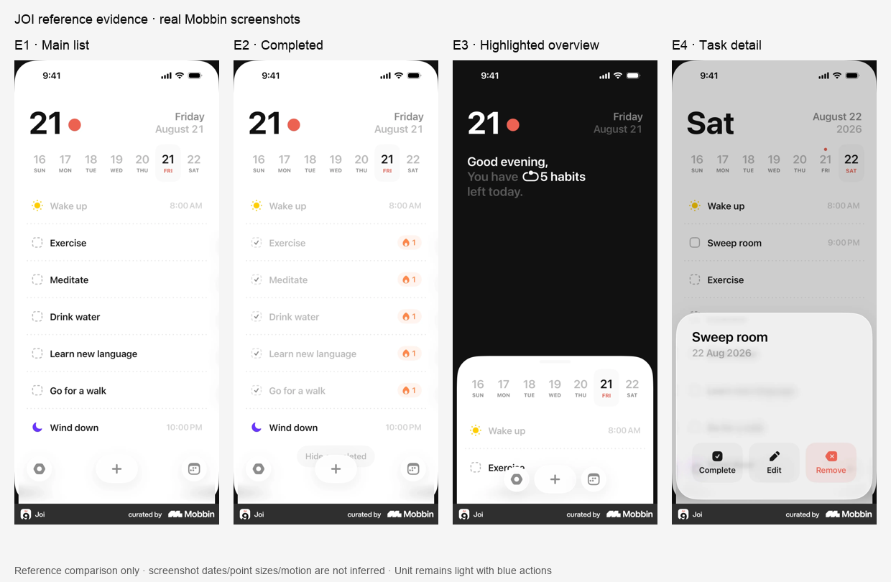

# JOI visual-language reference — 20 October 2026

## Recommendation

Borrow JOI’s **typographic emphasis, open page structure and quiet supporting rows**. Keep Unit’s native SF fonts, current numeric sizes, blue action accent, grayscale content, native bottom navigation and existing components. Start with a flatter Analytics summary header; do not shrink the whole interface or copy JOI’s calendar, floating navigation, dark overview or colored category marks.

Research only. No theme, component, asset or feature edits were made for this research. The worktree was merged with Main’s build-85 baseline `8e3cf4d` in `5ca3aab`; two merge conflicts retained Main’s exact shared-system source. Application source matches that baseline. Main may have advanced independently afterward.

## Identity and source scope

The reference is **Joi: Daily Planner & Organizer**, developer/seller **Alexey Sekachov**, App Store ID **6736852235**. The [official Joi site](https://joi.software/) links directly to this [App Store listing](https://apps.apple.com/us/app/joi-daily-planner-organizer/id6736852235). Apple’s lookup response independently returned the same identity, version **2.0.1**, release date **6 January 2026**; saved in [app-store-identity.json](joi-evidence-2026-10-20/app-store-identity.json).

Mobbin MCP is the primary visual source. Its results label the app **Joi** and show the calendar/task/habit timeline matching the official product. Mobbin did not supply the captured app version or capture date. Dates displayed inside screenshots are sample UI content, not capture dates. No Joy, Google Play “Joi Calendar,” Perplexity or Structured reference is used. Official marketing images support identity and the overview concept; they do not establish the latest runtime layout.

## Examined evidence

The sheet above resizes real downloaded screenshots; it does not redraw UI. Originals and source hashes are in [sources.json](joi-evidence-2026-10-20/sources.json).

| Ref | Actual source | Direct observation |
| --- | --- | --- |
| E1 | [Main timeline](https://mobbin.com/screens/b5e52caa-2f6e-4b5c-9175-29510e277fc1) · [local](joi-evidence-2026-10-20/mobbin-main-b5e52caa.webp) | White page; large day number; smaller right-aligned date; weekly strip; aligned task names and quiet trailing times; dotted row separators. |
| E2 | [Completed timeline](https://mobbin.com/screens/1d9b8c59-04c3-4026-9065-8a8282b51f77) · [local](joi-evidence-2026-10-20/mobbin-main-completed-1d9b8c59.webp) | Same row positions; completed content is much lighter, with checkmarks and small streak badges. Stronger unfinished row remains distinguishable. |
| E3 | [Highlighted daily overview](https://mobbin.com/screens/290d2250-0025-4b54-8522-9cea52258fda) · [local](joi-evidence-2026-10-20/mobbin-highlight-290d2250.webp) | Dark upper field; short narrative with selected words/count bright and supporting words gray; large open space; white lower timeline surface. “Highlight” describes this observed state, not a verified JOI feature name. |
| E4 | [Task detail/actions](https://mobbin.com/screens/c7624c7d-6687-423d-8fd8-221952f7d35d) · [local](joi-evidence-2026-10-20/mobbin-task-detail-c7624c7d.webp) | Large task title, quieter date, separated bottom action group with visible labels. The underlying page is dimmed and parts of the sheet are blurred. |
| E5 | [Calendar selection](https://mobbin.com/screens/1b6724ed-7524-4e8e-897f-a24590c52306) · [local](joi-evidence-2026-10-20/mobbin-calendar-1b6724ed.webp) | Month/year hierarchy, circular previous/next controls, a Today capsule and one selected date. Useful for control hierarchy, not a calendar proposal for Unit. |

Supporting official images examined: [App Store overview](joi-evidence-2026-10-20/official-store-01.jpg), [App Store widget](joi-evidence-2026-10-20/official-store-06.jpg), and [official-site timeline fragment](joi-evidence-2026-10-20/official-home-timeline.png). The site fragment has transparency; its viewing backdrop is not JOI’s page color. App Store images include marketing headlines/device framing and older sample dates.

## Observed language → current Unit owners

| Concern | Observation versus inference | Existing Unit mapping and boundary |
| --- | --- | --- |
| Type hierarchy | E1/E3 visibly separate a large focal item, medium identity text and quiet context. System-like sans appearance is observed; exact font family, point sizes and weights are unverified. | `AppFont.analyticsStatus` 34pt; `productHeading` 24pt; `sectionHeader`/`body` 17pt; `caption` 15pt; `muted` 13pt. These are verified Unit values, not extracted JOI specifications. Keep workout `setValue`/`numericInput` 30pt and `numericDisplay` 36pt. |
| Spacing | E1 uses repeated leading/trailing edges and more space between header/strip/list than within a row. Exact point spacing is unverified. | Compose with `AppSpacing.sm` 8, `smd` 12, `md` 16 and `lg` 24. Retain `AppCardList`’s existing row geometry; do not globally tighten rows or reduce 44pt targets. |
| Color | E1 is predominantly white/black/gray with coral, yellow and purple cues; E3 reverses contrast. E4/E5 have modal dimming, not a gray base theme. | Keep `AppColor.background`, `cardBackground`, `textPrimary`, `textSecondary`, `textTertiary`. Keep existing Unit `accent`/`accentSoft`; import none of JOI’s hues or dark surface treatment. Do not copy its very faint trailing/completed text for workout numbers. |
| Surface hierarchy | E1 is a continuous list rather than individual cards. E3/E4 reserve large rounded surfaces for a meaningful layer change. Blur/material implementation cannot be established from stills. | `AppScreen` for the page; `AppCardList`/`AppListRow` for related rows; `AppCard` only for a real group. Use existing `AppRadius.sm` 10, `md` 14, `card` 22 by current role. Do not derive new radii from screenshot silhouettes. |
| Controls | E4 pairs icons with action labels; E5 uses quiet secondary controls and a single selected state. E1 has floating custom bottom controls. | Reuse `AppPrimaryButton`, `AppSecondaryButton`, native controls and `AppSheetScreen`. Preserve native `TabView`. Keep the user’s Big-6-only icon boundary; JOI’s row marks do not authorize exercise icons elsewhere. |
| Motion/state | E1/E2 show distinguishable incomplete/completed states; E3/E4 show layer separation. Static images cannot prove transitions, duration, easing, gestures, haptics or hit testing. | Retain `ScaleButtonStyle`, `AppMotion` and existing reduced-motion/VoiceOver gates. No JOI motion settings are inferred or proposed. |

## Smallest discernible implementation proposal

**A — first assignment: `AppStatusSummaryCard` only.** Its current owner wraps a 34pt status, uppercased time label and explanation in a filled `AppCard`. Keep the existing text, 34pt status, information action and accessibility contract. Render the same stack directly on the page, with `AppSpacing.md` vertical breathing and `sm` internal gaps; make the time label sentence case at existing `AppFont.muted`. Keep the supporting explanation at `caption` and the information cue visible. The result is a clearly flatter, more editorial summary above the white lift cards, borrowing E3’s emphasis without a dark panel or larger heading. No new component or token.

**B — optional second assignment: `AppMainLiftCard.footer` only.** Change the tiny uppercase Best/Next labels to sentence-case `AppFont.muted`; retain 15pt evidence, existing spacing, chart, metrics and navigation. This reduces competing label styles without shrinking any value. Do not change shared card radius or the main lift layout in this pass.

**Keep:** existing `AppCardList` grouping, page/card colors, row heights, native navigation, current buttons and all logging geometry. No new primitives, colors, global font scaling or broad density adjustment. Main should assign these exact regions before implementation.

## Evidence limits and next verification

This is a contextual reference study, not a scored Unit page audit. No new build, Simulator, device installation or runtime interaction was performed. Exact JOI fonts, token values, motion and accessibility remain unverified. No claim is made that its very light metadata is accessible. Any implementation should be checked on the assigned Unit screen at standard and accessibility text sizes, with real long content, contrast, 44pt targets and reduced motion; keep workout numerics unchanged. No source-level blocker remains for the proposed existing-owner changes.
